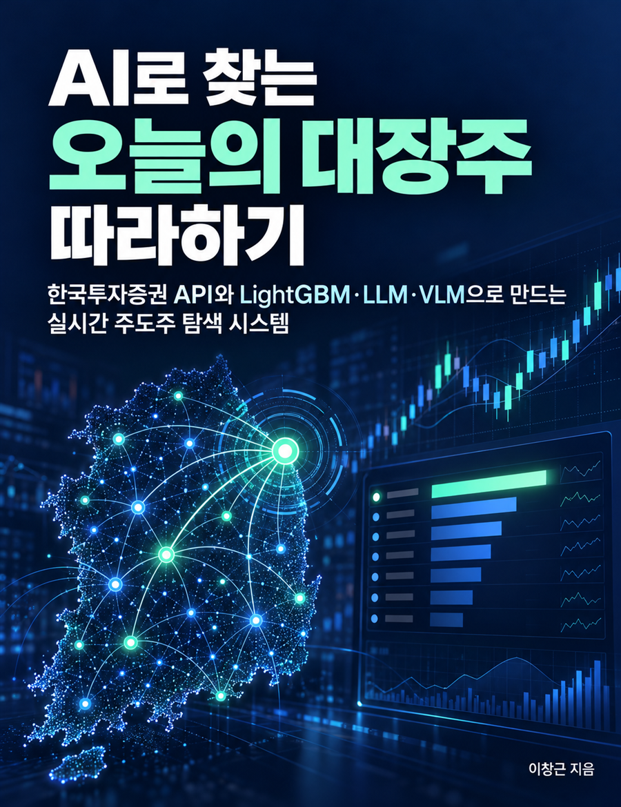

# AI로 찾는 오늘의 대장주 따라하기 — 예제 코드

<a href="https://wikidocs.net/book/21789"></a>

위키독스 도서 **《AI로 찾는 오늘의 대장주 따라하기》**(부제: 한국투자증권 API와 LightGBM·LLM·VLM으로 만드는 실시간 주도주 탐색 시스템)의 예제 코드 저장소입니다.

- 책 읽기: [https://wikidocs.net/book/21789](https://wikidocs.net/book/21789)

한국투자증권 Open API로 국내 주식 데이터를 수집하고, 규칙 기반 Leader Score → LightGBM 랭킹 → LLM·VLM 분석 순서로 **오늘의 주도 테마와 대장주 후보를 찾고, 그 선정 결과를 검증하는 AI 대장주 모니터**를 만듭니다.

> 현재 집필 중입니다. 각 장의 예제는 원고가 공개되는 순서대로 추가됩니다.

## 폴더 구성 (예정)

| 폴더 | 장 | 내용 |
|---|---|---|
| `ch02_kis_api/` | 2장 | API 인증, 국내주식 순위·시세 조회, 실시간 체결 수신 |
| `ch03_pipeline/` | 3장 | 종목 마스터, 일봉·분봉 수집, DuckDB 저장, 품질 검사 |
| `ch04_candidates/` | 4장 | 거래대금 집중도·상대강도·유동성 필터 |
| `ch05_themes/` | 5장 | 테마 사전, 동반 상승, 주도 테마 TOP 5 |
| `ch06_leader_score/` | 6장 | Leader Score 랭킹, 대장주 TOP 10 일일 리포트 |
| `ch07_realtime/` | 7장 | 장중 5분 재평가, 대장주 교체 탐지, 알림 |
| `ch08_lightgbm/` | 8장 | Feature Engineering, LGBMRanker 학습 |
| `ch09_llm/` | 9장 | 뉴스·공시 수집, LLM 분류·근거 검증, 뉴스 특성 결합 |
| `ch10_vlm/` | 10장 | AI 전용 차트 생성, VLM 판독 |
| `ch11_backtest/` | 11장 | 시점별 검증, NDCG@K, MFE·MAE, 거래비용 |
| `ch12_monitor/` | 12장 | Streamlit 대시보드 |
| `sample_data/` | 전체 | 재현용 샘플 데이터 |

## 시작하기

```bash
git clone https://github.com/ady95/leading-stock-tutorial.git
cd leading-stock-tutorial
python -m venv .venv
# Windows: .venv\Scripts\activate   /   macOS·Linux: source .venv/bin/activate
pip install -r requirements.txt
cp .env.example .env   # 발급받은 API 키를 입력
```

- Python 3.10 이상
- 한국투자증권 KIS Developers 앱키·앱시크릿 ([KIS Developers](https://apiportal.koreainvestment.com/))
- OPEN DART API 인증키 ([OPEN DART](https://opendart.fss.or.kr/))
- OpenAI API 키 (또는 OpenAI 호환 엔드포인트)

API 키와 계좌번호는 `.env`에만 저장하고 절대 커밋하지 마세요. `.env`는 `.gitignore`에 포함되어 있습니다.

## 유의사항

이 저장소의 코드는 연구·교육 목적입니다. 투자 권유가 아니며 수익을 보장하지 않습니다. 실제 투자 판단과 그 결과의 책임은 투자자 본인에게 있습니다. API 제공 범위와 호출 제한은 한국투자증권·OPEN DART의 최신 공식 문서를 확인하세요.
